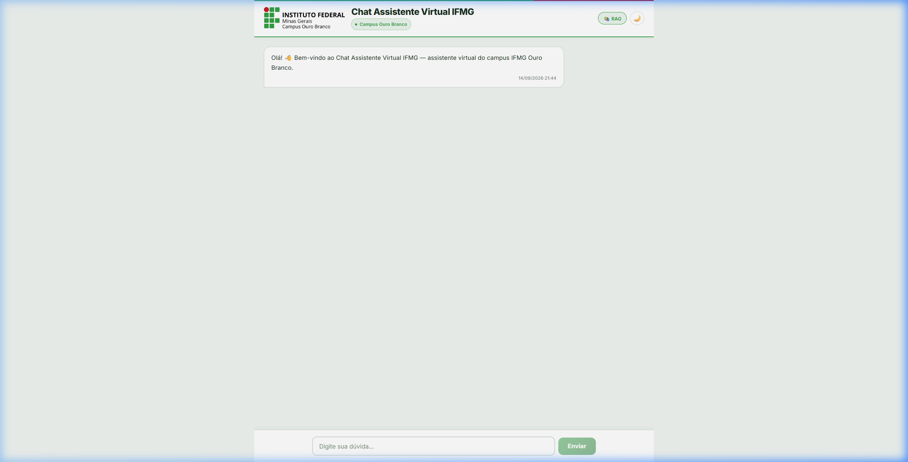
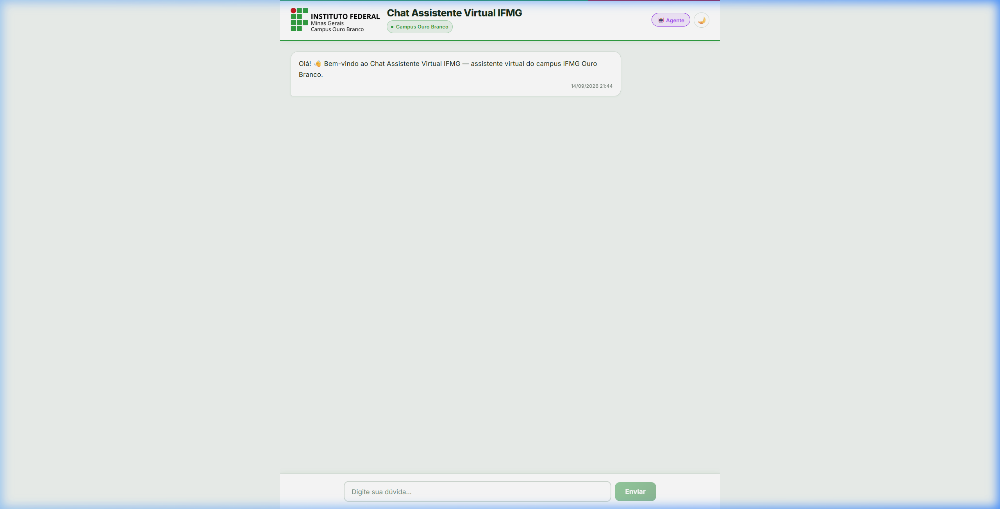

# Roteiro de Teste e Tutorial de Avaliação do Chat Assistente Virtual IFMG
**Projeto de Conclusão de Curso (TCC) — IFMG Campus Ouro Branco**  
**Autores:** Daniel G. D. Silva, Ederson N. F. G. Júnior  
**Endereço da Aplicação:** [https://chat.danielgsilva.com.br/](https://chat.danielgsilva.com.br/)

---

## Sumário
1. [Apresentação e Objetivo do Teste](#1-apresentação-e-objetivo-do-teste)
2. [Tutorial Passo a Passo de Uso do Chat](#2-tutorial-passo-a-passo-de-uso-do-chat)
   - [2.0 Identificação Anônima do Perfil (Etapas Iniciais)](#20-identificação-anônima-do-perfil-etapas-iniciais)
   - [2.1 Visão Geral da Interface](#21-visão-geral-da-interface)
   - [2.2 Modo RAG Clássico (📚)](#22-modo-rag-clássico-)
   - [2.3 Modo Agente MCP (🤖)](#23-modo-agente-mcp-)
   - [2.4 Alternando entre os Modos](#24-alternando-entre-os-modos)
   - [2.5 Como Registrar Feedback Individual nas Respostas (👍 / 👎)](#25-como-registrar-feedback-individual-nas-respostas---)
   - [2.6 Convite ao Formulário de Avaliação](#26-convite-ao-formulário-de-avaliação)
3. [Sugestão de Perguntas Acadêmicas para Testar](#3-sugestão-de-perguntas-acadêmicas-para-testar)
4. [Roteiro do Formulário de Avaliação (Questionário de 11 Perguntas)](#4-roteiro-do-formulário-de-avaliação-questionário-de-11-perguntas)
   - [Estrutura e Justificativa Metodológica](#estrutura-e-justificativa-metodológica)
   - [As 11 Questões do Formulário](#as-11-questões-do-formulário)
5. [Orientações para Tabulação e Uso dos Resultados no TCC](#5-orientações-para-tabulação-e-uso-dos-resultados-no-tcc)

---

## 1. Apresentação e Objetivo do Teste

Este guia foi elaborado para orientar os participantes do grupo piloto de testes do **Chat Assistente Virtual IFMG** (Campus Ouro Branco). O sistema é fruto de uma pesquisa de Trabalho de Conclusão de Curso (TCC) focada em inteligência artificial aplicada ao atendimento discente sob infraestrutura 100% local e aberta.

O assistente permite responder a dúvidas sobre normas acadêmicas, Projetos Pedagógicos de Curso (PPC), matrizes curriculares, estágios, regulamentos de TCC e trâmites institucionais, sem a necessidade de ler arquivos PDF extensos.

O diferencial do projeto é a coexistência de **duas abordagens técnicas de inteligência artificial** que podem ser alternadas com um clique pelo usuário:
1. **Modo RAG Clássico (`📚 RAG`):** Arquitetura linear e determinística. Realiza busca direta no banco de dados vetorial dos regulamentos e sintetiza a resposta de forma objetiva e com menor latência.
2. **Modo Agente MCP (`🤖 Agente`):** Arquitetura agêntica governada pelo *Model Context Protocol* (MCP). O modelo atua como um agente autônomo, decidindo quando acionar ferramentas formais de busca e exibindo explicitamente as fontes documentais auditadas que fundamentaram a resposta.

---

## 2. Tutorial Passo a Passo de Uso do Chat

### 2.0 Identificação Anônima do Perfil (Etapas Iniciais)

Antes de liberar o chat, o sistema apresenta uma janela com perguntas sobre o perfil acadêmico, exibidas **uma por tela**. Nenhum dado pessoal (nome, matrícula, e-mail) é coletado; o perfil é associado a um código anônimo.

- Uma barra de progresso no topo indica a etapa atual (ex.: `Etapa 2 de 3 · Curso`).
- Ao escolher uma opção, a janela avança sozinha para a próxima pergunta. O botão **← Voltar** permite corrigir uma resposta anterior.
- Na última etapa, o botão **Liberar Acesso ao Chat →** conclui a identificação.

| Vínculo | Etapas apresentadas |
|---|---|
| Aluno(a) de Graduação | Vínculo → Curso → Etapa do curso |
| Aluno(a) de Curso Técnico | Vínculo → Etapa do curso |
| Docente / Técnico-Administrativo | Vínculo → Confirmação do perfil |

---

### 2.1 Visão Geral da Interface

Ao acessar [https://chat.danielgsilva.com.br/](https://chat.danielgsilva.com.br/), a interface do chat é apresentada em tela cheia, com identidade visual oficial do IFMG Campus Ouro Branco:

- **Cabeçalho:** Contém o logotipo institucional, identificação do campus, o botão de alternância de modo (`📚 RAG` / `🤖 Agente`) e o botão de tema (Modo Claro / Modo Escuro).
- **Área Central de Mensagens:** Histórico da conversa, exibindo as perguntas enviadas e as respostas do assistente com formatação rica (Markdown, listas, tabelas e destaques).
- **Rodapé de Entrada:** Campo de digitação de texto com botão "Enviar". Durante o processamento da resposta, o campo é bloqueado temporariamente para evitar concorrência desnecessária.

---

### 2.2 Modo RAG Clássico (📚)

Por padrão, a aplicação inicia no **Modo RAG Clássico**. Neste modo, o botão no canto superior direito é exibido na cor verde com o ícone de livros:

```
[ 📚 RAG ]  (Botão Verde no Topo Direito)
```

#### Características do Modo RAG:
- **Alta Agilidade:** As respostas iniciam o fluxo de digitação em tempo real (*streaming*) de forma quase imediata (baixa latência).
- **Respostas Diretas:** O sistema foca em responder objetivamente à pergunta formulada.
- **Selo na Mensagem:** Cada mensagem gerada exibe o selo inferior `⚡ Modo: RAG Clássico`.

#### Captura de Tela — Modo RAG Inicial:


---

### 2.3 Modo Agente MCP (🤖)

Ao clicar no botão de alternância, o sistema passa para o **Modo Agente MCP**. O botão adota a cor roxa com o ícone de robô:

```
[ 🤖 Agente ]  (Botão Roxo no Topo Direito)
```

#### Características do Modo Agente:
- **Raciocínio Estruturado:** O modelo analisa a consulta, formula argumentos para a ferramenta de busca via MCP e sintetiza as evidências retornadas.
- **Indicador de Status do Pipeline:** Durante a busca, o sistema exibe mensagens de status dinâmico (ex: `Analisando pergunta...`, `Consultando base normativa...`).
- **Exibição Explícita de Fontes:** As respostas incluem metadados com as resoluções e PPCs utilizados, sinalizados pela seção `📚 Fontes: [PPC BSI] [Regulamento Didático]`.
- **Selo na Mensagem:** Cada resposta é demarcada com a etiqueta `🤖 Modo: Agente MCP`.

#### Captura de Tela — Modo Agente Ativo:


---

### 2.4 Alternando entre os Modos

Para comparar o desempenho e o estilo de resposta entre as duas abordagens:
1. **Passo 1:** Digite sua pergunta no modo inicial (`📚 RAG`) e clique em **Enviar**.
2. **Passo 2:** Aguarde a conclusão da resposta e leia o conteúdo gerado.
3. **Passo 3:** Clique no botão de alternância no canto superior direito. Ele mudará de `📚 RAG` (verde) para `🤖 Agente` (roxo).
4. **Passo 4:** Envie a mesma pergunta (ou uma consulta correlata) e compare:
   - A velocidade de início da digitação;
   - A profundidade e o estilo do texto gerado;
   - A presença das tags de fontes consultadas ao final da resposta.

> **Observação:** Durante a geração de uma resposta (enquanto o texto estiver sendo gerado via *streaming*), o botão de alternância e o campo de digitação ficam desabilitados para preservar a estabilidade da sessão.

---

### 2.5 Como Registrar Feedback Individual nas Respostas (👍 / 👎)

Abaixo de cada resposta fornecida pelo assistente, há dois botões de avaliação rápida:
- **👍 (Útil / Correta):** Indica que a resposta foi precisa, clara e ajudou a esclarecer a dúvida.
- **👎 (Não útil / Incorreta):** Indica que a resposta continha imprecisão, não respondeu à pergunta ou omitiu regras essenciais.

Ao clicar em um dos botões, seu voto é registrado instantaneamente no banco de dados do projeto, auxiliando no cálculo da taxa de aprovação para a pesquisa do TCC.

---

### 2.6 Convite ao Formulário de Avaliação

Após a **4ª pergunta respondida** (somando os dois modos), o chat exibe uma janela de agradecimento com o link do formulário de avaliação ([https://forms.gle/P1VYPyDh2XcmnTX68](https://forms.gle/P1VYPyDh2XcmnTX68)).

- **📝 Responder formulário ↗:** abre o formulário em uma nova aba. Depois de enviar, basta retornar à aba do chat para continuar perguntando.
- **Continuar no chat:** fecha a janela sem abrir o formulário.
- Após a exibição do convite, o botão **📝 Formulário** fica disponível no cabeçalho para acesso posterior.

> **Observação:** Respostas interrompidas ou com erro não entram na contagem. O convite é exibido uma vez por participante; ao iniciar uma nova sessão, a contagem recomeça.

---

## 3. Sugestão de Perguntas Acadêmicas para Testar

Para que o teste explore as diferentes capacidades de recuperação semântica e normativa do sistema, recomendamos formular perguntas com base nos seguintes tópicos reais do campus:

### Bloco A: Disciplinas, Ementas e Pré-requisitos
- *"Quais são os pré-requisitos para cursar Banco de Dados I no curso de Sistemas de Informação?"*
- *"Qual é a carga horária e a ementa da disciplina de Inteligência Artificial?"*
- *"Quais disciplinas compõem o 4º período da matriz de BSI?"*

### Bloco B: Regulamento de TCC e Estágio
- *"Quais são as etapas e prazos para a entrega do projeto de TCC?"*
- *"Quantas horas mínimas de estágio supervisionado são obrigatórias para a conclusão do curso?"*
- *"Quem pode ser o orientador do meu trabalho de conclusão de curso?"*

### Bloco C: Normas Gerais de Ensino e Trâmites Acadêmicos
- *"Como funciona o processo de trancamento total de matrícula e qual o prazo regulamentar?"*
- *"Quantas horas de Atividades Complementares de Graduação (ACG) é necessário integralizar?"*
- *"Qual é a média mínima para aprovação direta em uma disciplina e como funciona o exame final?"*

---

## 4. Roteiro do Formulário de Avaliação (Questionário de 11 Perguntas)

### Estrutura e Justificativa Metodológica
O formulário de coleta de dados foi projetado para ser objetivo, rápido de preencher (cerca de 3 a 4 minutos) e aderente aos modelos de aceitação tecnológica (TAM — *Technology Acceptance Model*) e de usabilidade, dividindo-se em:
- **Perfil do Respondente (Q1):** Contextualização acadêmica e estratificação por fase do curso.
- **Avaliação do Modo RAG Clássico (Q2 e Q3):** Latência subjetiva percebida e assertividade objetiva.
- **Avaliação do Modo Agente MCP (Q4 e Q5):** Latência subjetiva percebida e assertividade objetiva no paradigma agêntico (permitindo comparação direta e pareada com Q2 e Q3).
- **Auditoria de Confiabilidade e Alucinações (Q6):** Identificação da natureza de eventuais erros (recusa adequada vs. divergência leve vs. alucinação factual evidente).
- **Percepção Comparativa e Coerência (Q7):** Avaliação de qual modo apresentou maior assertividade e coerência com os documentos, ou preferência por ambos disponíveis.
- **Usabilidade e Impacto Institucional (Q8 e Q9):** Facilidade da interface web e redução de gargalos de atendimento presencial (TAM).
- **Mapeamento de Novas Ferramentas MCP (Q10):** Levantamento quantitativo para a seção de Trabalhos Futuros do TCC.
- **Auditoria de Consultas e Sugestões Livres (Q11):** Coleta de perguntas não atendidas para alimentação do *Golden Dataset* e aprimoramento contínuo.

---

### As 11 Questões do Formulário

#### [Questão 1] — Perfil do Respondente
**Pergunta:** Qual é o seu curso e em qual período ou fase você se encontra no IFMG Campus Ouro Branco?  
- **Tipo:** Seleção única.  
- **Opções:**
  - ( ) Bacharelado em Sistemas de Informação — Fase inicial (1º ao 3º período)
  - ( ) Bacharelado em Sistemas de Informação — Fase intermediária (4º ao 6º período)
  - ( ) Bacharelado em Sistemas de Informação — Fase concluinte / TCC / Estágio (7º ao 8º período)
  - ( ) Outro curso de graduação (Administração, Engenharia Metalúrgica ou Licenciatura em Pedagogia)
  - ( ) Curso técnico (integrado ou subsequente)
  - ( ) Docente ou servidor técnico-administrativo

---

#### [Questão 2] — Desempenho e Tempo de Resposta no Modo RAG Clássico (📚)
**Pergunta:** Quanto ao tempo de resposta no Modo RAG Clássico (intervalo transcorrido até o início da digitação e o término da resposta), como você avalia a velocidade do sistema?  
- **Tipo:** Escala Likert de 5 pontos.  
- **Opções:**
  - (1) Muito lento (tempo de espera excessivo, que desestimula o uso)
  - (2) Lento (resposta perceptivelmente demorada)
  - (3) Aceitável (tempo compatível com uma consulta a assistentes virtuais locais)
  - (4) Rápido (início imediato da digitação e fluxo de leitura fluido)
  - (5) Muito rápido (resposta quase instantânea, proporcionando excelente experiência)

---

#### [Questão 3] — Precisão e Clareza no Modo RAG Clássico (📚)
**Pergunta:** No Modo RAG Clássico, as respostas foram diretas, objetivas e esclareceram adequadamente a dúvida apresentada?  
- **Tipo:** Escala Likert de 5 pontos.  
- **Opções:**
  - (1) Discordo totalmente (respostas confusas, evasivas ou sem relação com a dúvida)
  - (2) Discordo parcialmente (respostas incompletas ou excessivamente vagas)
  - (3) Neutro (respostas medianas ou apenas parcialmente esclarecedoras)
  - (4) Concordo parcialmente (respostas claras e suficientes para a dúvida)
  - (5) Concordo totalmente (respostas precisas, diretas e fundamentadas)

---

#### [Questão 4] — Desempenho e Tempo de Resposta no Modo Agente MCP (🤖)
**Pergunta:** Quanto ao tempo de resposta no Modo Agente MCP (intervalo transcorrido até o início da digitação e o término da resposta), como você avalia a velocidade do sistema?  
- **Tipo:** Escala Likert de 5 pontos.  
- **Opções:**
  - (1) Muito lento (tempo de espera excessivo, que desestimula o uso)
  - (2) Lento (resposta perceptivelmente demorada)
  - (3) Aceitável (tempo compatível com uma consulta a assistentes virtuais locais)
  - (4) Rápido (início imediato da digitação e fluxo de leitura fluido)
  - (5) Muito rápido (resposta quase instantânea, proporcionando excelente experiência)

---

#### [Questão 5] — Precisão e Clareza no Modo Agente MCP (🤖)
**Pergunta:** No Modo Agente MCP, as respostas foram diretas, objetivas e esclareceram adequadamente a dúvida apresentada?  
- **Tipo:** Escala Likert de 5 pontos.  
- **Opções:**
  - (1) Discordo totalmente (respostas confusas, evasivas ou sem relação com a dúvida)
  - (2) Discordo parcialmente (respostas incompletas ou excessivamente vagas)
  - (3) Neutro (respostas medianas ou apenas parcialmente esclarecedoras)
  - (4) Concordo parcialmente (respostas claras e suficientes para a dúvida)
  - (5) Concordo totalmente (respostas precisas, diretas e fundamentadas)

---

#### [Questão 6] — Auditoria de Confiabilidade e Ausência de Alucinações
**Pergunta:** Durante a utilização de ambos os modos, qual das situações a seguir melhor descreve o comportamento do assistente em relação à veracidade das informações apresentadas?  
- **Tipo:** Seleção única.  
- **Opções:**
  - ( ) **Totalmente confiável:** Não observei informações falsas ou inventadas; todas as respostas foram consistentes com as normas institucionais.
  - ( ) **Recusa consciente:** O assistente informou expressamente que não possuía a informação nos documentos cadastrados quando consultado sobre temas não cobertos pela base (comportamento correto).
  - ( ) **Divergência leve ou omissão:** A resposta foi parcialmente correta, mas omitiu algum pré-requisito secundário ou detalhe específico da norma.
  - ( ) **Alucinação factual evidente:** O sistema inventou nomes de disciplinas inexistentes, regras contrárias aos regulamentos ou dados incorretos.
  - ( ) **Não sei avaliar:** Não possuo conhecimento prévio suficiente das normas acadêmicas para identificar eventuais imprecisões técnicas.

---

#### [Questão 7] — Percepção Comparativa e Coerência das Respostas
**Pergunta:** Ao comparar a sua experiência com os dois modos, em qual deles você percebeu respostas com maior assertividade e coerência em relação aos documentos e normas do campus, ou você prefere que ambos os modos estejam disponíveis?  
- **Tipo:** Seleção única.  
- **Opções:**
  - ( ) **Modo RAG Clássico:** Percebi respostas mais assertivas e coerentes com os documentos no RAG Clássico.
  - ( ) **Modo Agente MCP:** Percebi respostas mais assertivas e coerentes com os documentos no Agente MCP.
  - ( ) **Ambos foram semelhantes:** Percebi nível equivalente de assertividade e coerência com os documentos em ambos os modos.
  - ( ) **Prefiro ambos disponíveis:** Considero ambos úteis e prefiro que os dois modos continuem disponíveis no assistente.
  - ( ) **Indiferente / Nenhum dos modos:** Não percebi coerência satisfatória em nenhum dos modos ou não tenho preferência definida.

---

#### [Questão 8] — Usabilidade da Interface Web (TAM — Facilidade de Uso Percebida)
**Pergunta:** Como você avalia a experiência de uso da interface web (facilidade de alternância de modos no cabeçalho, botões de avaliação 👍/👎, digitação em tempo real e visualização em computadores e dispositivos móveis)?  
- **Tipo:** Escala Likert de 5 pontos.  
- **Opções:**
  - (1) Muito difícil ou confusa (dificuldades recorrentes de navegação e comandos)
  - (2) Difícil (interface funcional, porém com elementos pouco intuitivos)
  - (3) Regular (atende às necessidades básicas de interação de um chat)
  - (4) Boa e intuitiva (interação limpa, agradável e de fácil compreensão)
  - (5) Excelente (interface moderna, fluida e de navegação simples em qualquer dispositivo)

---

#### [Questão 9] — Utilidade Institucional e Redução de Gargalos (TAM — Utilidade Percebida)
**Pergunta:** Na sua percepção, em que medida a disponibilização permanente deste assistente virtual reduz a necessidade de comparecimento presencial à secretaria/coordenação e dispensa a leitura manual de arquivos PDF extensos?  
- **Tipo:** Escala Likert de 5 pontos.  
- **Opções:**
  - (1) Não reduz (permanece a dependência integral de atendimento presencial e consulta manual)
  - (2) Reduz pouco (mostra-se útil apenas em situações raras ou atípicas)
  - (3) Reduz moderadamente (auxilia na resolução de dúvidas rotineiras de menor complexidade)
  - (4) Reduz expressivamente (soluciona a maior parte das dúvidas acadêmicas com rapidez e autonomia)
  - (5) Reduz substancialmente (proporciona autonomia integral na consulta a regulamentos, ementas e normas institucionais)

---

#### [Questão 10] — Mapeamento de Novas Demandas para Ferramentas MCP (Trabalhos Futuros)
**Pergunta:** Quais serviços e informações do cotidiano acadêmico do IFMG você gostaria que fossem integrados como novas ferramentas do assistente virtual (dados que hoje não constam nos regulamentos e PPCs em PDF)?  
- **Tipo:** Múltipla escolha (marque todas as opções que considerar relevantes) com campo aberto adicional.  
- **Opções (Mapeadas para Ferramentas MCP):**
  - [ ] **Transporte e horários de ônibus:** Consulta em tempo real a itinerários, pontos de parada e horários de linhas municipais e intermunicipais de acesso ao campus. *(Tool MCP: `search_transport_routes`)*
  - [ ] **Cardápio e serviços da cantina:** Consulta ao cardápio diário e aos horários de funcionamento do refeitório e da cantina institucional. *(Tool MCP: `get_cafeteria_menu`)*
  - [ ] **Localização de espaços no campus:** Guia de localização física de blocos, salas de aula, laboratórios especializados e setores administrativos. *(Tool MCP: `locate_campus_facility`)*
  - [ ] **Diretório de contatos e atendimento docente:** Catálogo de e-mails institucionais, ramais telefônicos e horários de atendimento presencial de professores e coordenadores. *(Tool MCP: `get_staff_directory`)*
  - [ ] **Mural de avisos dinâmicos e notícias:** Alertas em tempo real sobre suspensão ou alteração de aulas, eventos acadêmicos e palestras. *(Tool MCP: `fetch_campus_notices`)*
  - [ ] **Prazos do calendário acadêmico:** Lembretes e consultas sobre prazos de trancamento de matrícula, aproveitamento de estudos e rematrícula no SIGAA. *(Tool MCP: `query_academic_calendar`)*
  - [ ] **Assistência estudantil e editais de bolsas:** Informações consolidadas sobre editais abertos de auxílio-permanência, bolsas de monitoria e iniciação científica. *(Tool MCP: `list_student_grants`)*
  - [ ] **Outro (especifique):** __________________________________________________

---

#### [Questão 11] — Auditoria de Consultas e Sugestões Livres (Golden Dataset)
**Pergunta:** Espaço aberto para auditoria: cite perguntas específicas às quais o assistente **não soube responder satisfatoriamente** (ou nas quais apresentou informações imprecisas) e registre sugestões para o aprimoramento da ferramenta e da pesquisa.  
- **Tipo:** Texto descritivo aberto (opcional).  
- **Campos sugeridos no formulário:**
  - *Campo 1 (Auditoria de Falhas):* Pergunta(s) enviada(s) em que o assistente apresentou erro ou resposta insatisfatória: `[ Campo de texto ]`
  - *Campo 2 (Sugestões e Comentários):* Críticas, observações gerais ou sugestões de melhoria: `[ Campo de texto ]`

---

## 5. Orientações para Tabulação e Uso dos Resultados no TCC

As respostas obtidas por meio deste instrumento permitirão enriquecer diretamente a **Seção 4 (Experimentos e Resultados)**, a **Seção 5 (Conclusão e Trabalhos Futuros)** do TCC e os slides da apresentação de defesa:

1. **Estratificação Amostral (Questão 1):**
   - Mapear a representatividade dos cursos e períodos. Demonstrar na Seção 4.2 que discentes concluintes de BSI (que conhecem o PPC detalhadamente) atuaram como validadores confiáveis da acurácia factual das ementas e regulamentos de TCC e estágio.
2. **Gráficos de Escala Likert e Modelo TAM (Questões 2, 3, 4, 5, 8 e 9):**
   - Calcular média ponderada ($\mu$) e desvio-padrão ($\sigma$) para cada dimensão avaliada.
   - Gerar gráficos de barras divergentes (100% empilhadas) para ilustrar os construtos de Facilidade de Uso Percebida (PEOU — Q8) e Utilidade Percebida (PU — Q9).
   - Correlacionar a percepção de agilidade (Q2 e Q4) com as métricas de tempo real de execução cronometradas no servidor (Tabela 2 do artigo).
3. **Comparação Pareada entre Modos (Q2 vs Q4 e Q3 vs Q5):**
   - Comparar diretamente a velocidade percebida (Q2 vs Q4) e a assertividade/clareza (Q3 vs Q5) entre o Modo RAG Clássico e o Modo Agente MCP. Essa análise pareada permite comprovar empiricamente o *trade-off* entre latência de resposta e precisão explicativa em cada arquitetura.
4. **Taxa de Fidelidade Factual e Análise de Alucinações (Questão 6):**
   - Isolar a ocorrência de alucinações severas das recusas corretas e das omissões leves. Cruzar a taxa de confiabilidade com os registros de votos da tabela `chat_feedbacks` da aplicação.
5. **Percepção Comparativa e Preferência (Questão 7):**
   - Gerar gráfico de pizza/rosca para ilustrar a percepção de coerência e assertividade documental dos usuários e mensurar o percentual que prefere a coexistência dos dois modos.
6. **Gráfico de Pareto para Trabalhos Futuros (Questão 10):**
   - Ordenar as demandas mais votadas em gráfico de barras horizontais, fornecendo embasamento empírico irrefutável na Seção 5 para o desenvolvimento de novas ferramentas MCP conectadas a serviços em tempo real (transporte, cardápio, calendários e avisos).
7. **Refinamento do Golden Dataset e Análise de Casos de Borda (Questão 11):**
   - Incorporar as perguntas com falha relatadas pelos usuários ao conjunto de testes de referência (*Golden Dataset*), permitindo a análise qualitativa de limitações decorrentes do modelo compacto de 4 bilhões de parâmetros na Seção 4.4.
