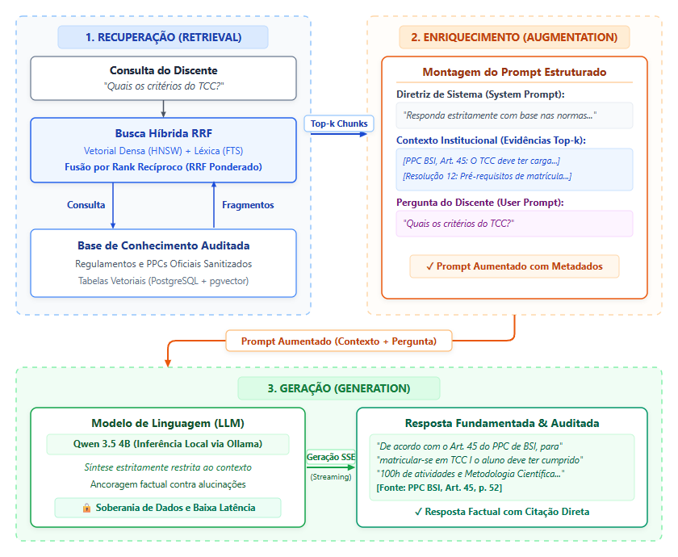
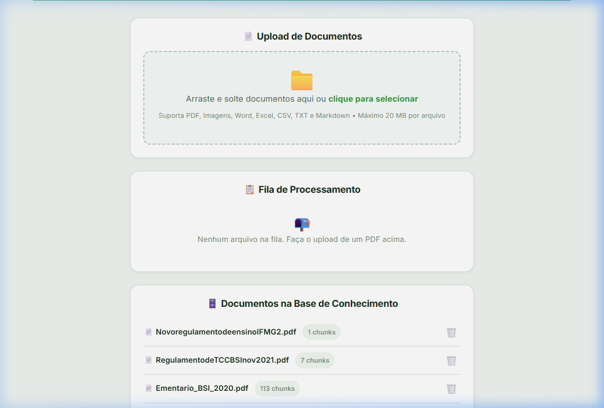
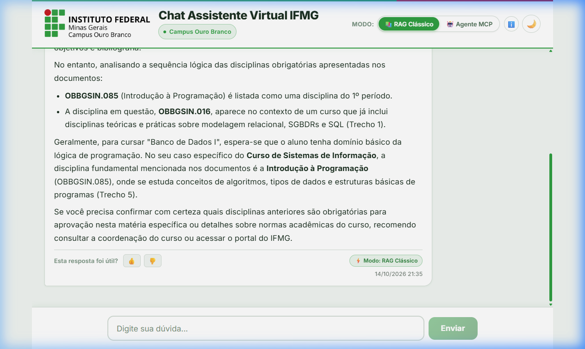

<!-- _class: capa -->
<!-- _paginate: false -->
<!-- _footer: '' -->

# Desenvolvimento e Avaliação Comparativa de Assistente Virtual Acadêmico
## RAG Clássico vs. Agentic RAG via Model Context Protocol (MCP)

  
<strong>Apresentação Parcial do Trabalho de Conclusão de Curso (TCC II)</strong>

  
<strong>Discente:</strong> Daniel G. D. Silva &nbsp;|&nbsp; <strong>Orientador:</strong> Prof. Me. Ederson N. F. G. Júnior

  
<strong>Instituição:</strong> Instituto Federal de Minas Gerais (IFMG) — Campus Ouro Branco

  
<strong>Curso:</strong> Bacharelado em Sistemas de Informação &nbsp;|&nbsp; <strong>Outubro de 2026</strong>

---

# Slide 1 — Introdução: Contextualização e Escopo

  

    <h3>Contextualização e Motivação</h3>
    <ul>
      <li><strong>Labirinto Normativo:</strong> Diretrizes acadêmicas dispersas em múltiplos PDFs extensos (PPCs, regulamentos de TCC, estágio, ementas e calendários);</li>
      <li><strong>Esforço Cognitivo:</strong> Alunos enfrentam barreiras para localizar regras operacionais de trancamento, pré-requisitos e atividades complementares;</li>
      <li><strong>Sobrecarga Administrativa:</strong> Demandas repetitivas sobrecarregam secretarias e coordenações de curso.</li>
    </ul>
  

  

    <h3>Escopo da Solução</h3>
    <table style="font-size: 13.5px;">
      <thead>
        <tr>
          <th style="width: 18%;">Dimensão</th>
          <th style="width: 41%;">O que o projeto faz</th>
          <th style="width: 41%;">O que o projeto não faz</th>
        </tr>
      </thead>
      <tbody>
        <tr>
          <td><strong>Fontes de dados</strong></td>
          <td>FAZ Responde a dúvidas com base em documentos oficiais do campus (PPC, ementário e regulamentos).</td>
          <td>NÃO FAZ Não acessa notas, histórico ou dados pessoais do aluno (SUAP).</td>
        </tr>
        <tr>
          <td><strong>Operação</strong></td>
          <td>FAZ Somente consulta e leitura, comparando <strong>RAG Clássico</strong> e <strong>RAG Agêntico (MCP)</strong>.</td>
          <td>NÃO FAZ Não altera cadastros nem executa solicitações, como trancamento de matrícula.</td>
        </tr>
        <tr>
          <td><strong>Infraestrutura</strong></td>
          <td>FAZ Roda 100% em hardware local, com modelos de código aberto.</td>
          <td>NÃO FAZ Não usa APIs pagas em nuvem, evitando custos e exposição de dados.</td>
        </tr>
      </tbody>
    </table>
  

---

# Slide 2 — Problema e Objetivos da Pesquisa

  <h3 style="color: #92400e;">Descrição e Relevância do Problema</h3>
  

    Modelos de linguagem generativos (LLMs) produzem respostas probabilísticas sujeitas a <strong>alucinações factuais</strong>, inventando prazos e normas inexistentes. Por outro lado, soluções baseadas em nuvem comercial geram custos em escala e fragilidade à privacidade. É imperativo investigar arquiteturas locais que garantam <strong>ancoramento factual rigoroso</strong>.
  

  <h3 style="color: #6b21a8;">Pergunta da Pesquisa</h3>
  

    <em>"Como viabilizar um assistente virtual acadêmico 100% local e soberano, e quais são os <em>trade-offs</em> dessa abordagem em latência, governança e assertividade entre RAG Clássico e RAG Agêntico via MCP, utilizando modelos compactos em hardware modesto?"</em>
  

  <h3>Objetivos do Trabalho</h3>
  

    <strong>Objetivo Geral:</strong> Projetar, implementar e avaliar comparativamente um assistente virtual acadêmico para o IFMG Campus Ouro Branco operando em infraestrutura local.
  

  
Objetivos Específicos:

  <ol style="font-size: 14px; padding-left: 18px;">
    <li>Estruturar pipeline de ingestão adaptativa com <em>chunking</em> semântico orientado ao domínio normativo;</li>
    <li>Implementar busca híbrida (BGE-M3 + FTS com RRF ponderado) e servidor MCP via <em>stdio</em> restrito;</li>
    <li>Desenvolver controle leve de concorrência em GPU (semáforo de VRAM) para execução estável;</li>
    <li>Mensurar latências de pipeline e realizar testes preliminares de campo com discentes.</li>
  </ol>

---

# Slide 3 — Trabalhos Relacionados e Diferencial da Proposta

<table>
  <thead>
    <tr>
      <th style="width: 20%;">Trabalho / Autor</th>
      <th style="width: 26%;">Abordagem Tecnológica</th>
      <th style="width: 27%;">Limitações Identificadas</th>
      <th style="width: 27%;">Diferencial da Nossa Proposta</th>
    </tr>
  </thead>
  <tbody>
    <tr>
      <td><strong>Helena / UFOP</strong> <small>(Monteiro, 2021)</small></td>
      <td>PLN Tradicional via IBM Watson Assistant</td>
      <td>Mapeamento manual de intenções; fluxos rígidos que quebram com mudanças em resoluções</td>
      <td><strong>Extração Dinâmica via RAG:</strong> Atualização imediata com ingestão de novos regulamentos em PDF</td>
    </tr>
    <tr>
      <td><strong>PROGRAD / UFOP</strong> <small>(Barbosa, 2023)</small></td>
      <td>RAG com LlamaIndex + ChatGPT (OpenAI)</td>
      <td>Custo recorrente por token em nuvem paga; dependência de conexão externa e dados de terceiros</td>
      <td><strong>Soberania e Privacidade:</strong> Execução 100% local (Ollama) com banco vetorial persistente</td>
    </tr>
    <tr>
      <td><strong>Tutoria Adaptativa</strong> <small>(Modran, 2025)</small></td>
      <td>RAG + MCP e ACP para modulação pedagógica</td>
      <td>Foco em perfil de aprendizagem, sem isolamento formal de leitura nem auditoria estrita</td>
      <td><strong>Governança via MCP:</strong> Ferramentas isoladas operando em modo estrito de leitura (<em>read-only</em>)</td>
    </tr>
    <tr>
      <td><strong>Gestão OpenStack</strong> <small>(Oliveira, 2025)</small></td>
      <td>Multiagente MCP para automação de infra</td>
      <td>Agentes com permissão de escrita/modificação ativa em serviços do sistema operacional</td>
      <td><strong>Auditabilidade Documental:</strong> Foco exclusivo em ancoramento factual com fontes explícitas</td>
    </tr>
  </tbody>
</table>

  

    <strong>Viabilidade Real do <em>Self-Hosted</em>:</strong> o sistema roda em um servidor local (<em>homelab</em>) com GPU, usando um modelo compacto de 4B parâmetros, sem custo por token nem envio de dados a terceiros. Em testes, o RAG Clássico começou a responder em <strong>1,5 a 2,2 s</strong>, e um semáforo de VRAM mantém o serviço estável com requisições simultâneas. O mesmo ambiente comparou o <strong>RAG Clássico</strong> com o <strong>Agente MCP</strong>.
  

---

# Slide 4 — Metodologia (1/3): Arquitetura e Tecnologias

  

    <h3>Pilha Tecnológica 100% Local e Soberana</h3>
    <ul>
      <li><strong>Estrutura em Monorepo (npm workspaces):</strong>
        <ul>
          <li><code>packages/web</code>: React 19 + TypeScript + Vite (interface web e streaming SSE);</li>
          <li><code>packages/api</code>: Backend Node.js/Express + controle assíncrono;</li>
          <li><code>packages/mcp-server</code>: Servidor de ferramentas isolado via protocolo MCP.</li>
        </ul>
      </li>
      <li><strong>Modelos de Inteligência Artificial (Ollama local):</strong>
        <ul>
          <li><strong>Qwen 3.5 4B:</strong> Reescrita de consulta, raciocínio agêntico e geração;</li>
          <li><strong>BGE-M3:</strong> Vetorização multilíngue densa (1024 dimensões).</li>
        </ul>
      </li>
      <li><strong>Banco Vetorial:</strong> PostgreSQL 16 + <em>pgvector</em> (índices HNSW).</li>
    </ul>
  

  

    
    
Figura 1: Arquitetura geral, fluxo de dados do pipeline RAG e ingestão.

  

---

# Slide 5 — Metodologia (2/3): Ingestão e Sanitização Adaptativa

  

    <h3>1. Extração Multiformato</h3>
    
Leitura resiliente de documentos heterogêneos:

    <ul style="font-size: 13.5px; padding-left: 16px;">
      <li><strong>PDF Estruturado:</strong> <em>LiteParse</em> preservando hierarquia de seções e títulos;</li>
      <li><strong>PDF Escaneado:</strong> OCR local via <em>tesseract.js</em>;</li>
      <li>Planilhas curriculares e matrizes em Markdown.</li>
    </ul>
  

  

    <h3>2. Sanitização em 8 Etapas</h3>
    <ol style="font-size: 12.5px; padding-left: 16px; margin: 0;">
      <li>Filtragem de ruídos de OCR e caracteres nulos;</li>
      <li>Junção de hifenizações em quebra de linha;</li>
      <li>Poda de cabeçalhos e rodapés repetitivos;</li>
      <li>Eliminação de formulários em branco;</li>
      <li>Linearização textual de tabelas curriculares;</li>
      <li>Remoção de numeração isolada de páginas;</li>
      <li>Padronização formal antes de <em>Art.</em> e <em>Capítulo</em>;</li>
      <li>Normalização de espaços e pontuação.</li>
    </ol>
  

  

    <h3>3. Domain-Driven Chunking</h3>
    
Segmentação orientada à semântica normativa:

    <ul style="font-size: 13.5px; padding-left: 16px;">
      <li><strong>Syllabus Strategy:</strong> Disciplina completa mantida no mesmo chunk (código, ementa, créditos e bibliografia);</li>
      <li><strong>Normative Strategy:</strong> Preserva artigos, parágrafos e incisos sem fracionamento cego;</li>
      <li>Prefixo contextual injetado em cada vetor.</li>
    </ul>
  

  

    <strong>Benefício Chave:</strong> Elimina a quebra de artigos regulamentares no meio de frases, problema comum em segmentações cegas baseadas apenas em contagem de caracteres.
  

---

# Slide 6 — Metodologia (3/3): RAG Clássico vs. Agente MCP e GPU

  

    <h3>RAG Clássico (Linear)</h3>
    <ul>
      <li><strong>Fluxo Determinístico:</strong> Reescrita de consulta $\to$ Busca Híbrida RRF $\to$ Síntese direta com streaming SSE;</li>
      <li><strong>Busca Híbrida Calibrada ($\alpha = 0,5$):</strong> Equilíbrio exato entre semântica vetorial (BGE-M3) e termos léxicos (FTS);</li>
      <li><strong>Menor Latência:</strong> Sem ciclos intermediários de decisão.</li>
    </ul>
  

  

    <h3>RAG Agêntico via MCP (Autônomo)</h3>
    <ul>
      <li><strong>Comunicação via stdio:</strong> Processo desacoplado com contrato de schema JSON rigoroso;</li>
      <li><strong>Ferramenta Dedicada:</strong> <code>search_ifmg_knowledge</code> operando exclusivamente em modo de leitura (<em>read-only</em>);</li>
      <li><strong>Rastreabilidade de Fontes:</strong> Anexa metadados auditáveis com o nome do regulamento e trecho citado.</li>
    </ul>
  

  <h3 style="margin-top: 0; color: #92400e;">Engenharia de Concorrência: Semáforo Assíncrono de VRAM</h3>
  

    Para prevenir travamentos por estouro de memória de vídeo (<em>Out-Of-Memory</em> — OOM) no servidor homelab, implementou-se um <strong>semáforo de concorrência em memória</strong> (<code>OLLAMA_MAX_CONCURRENT = 2</code>). Requisições excedentes são enfileiradas com timeout gracioso, dispensando dependências pesadas de corretores externos (Redis/RabbitMQ).
  

---

# Slide 7 — Resultados Preliminares (1/3): Métricas de Latência

  <h3 style="color: #0369a1;">Ambiente Computacional Homelab</h3>
  <ul>
    <li><strong>Servidor Local</strong> (Ubuntu 24.04, <em>self-hosted</em>):
      <ul>
        <li>CPU: AMD Ryzen 5 7500F (6 núcleos / 12 <em>threads</em>);</li>
        <li>GPU: NVIDIA RTX 5060 Ti, 16 GB de VRAM (CUDA);</li>
        <li>Memória RAM: 32 GB;</li>
        <li>Armazenamento: SSD de 512 GB (PCIe Gen3).</li>
      </ul>
    </li>
    <li><strong>Modelos Locais:</strong>
      <ul>
        <li>LLM: <em>Qwen 3.5 4B Instruct</em> (4 bilhões de parâmetros, contexto de 2048 <em>tokens</em>);</li>
        <li>Embeddings: <em>BGE-M3</em> (1024 dimensões).</li>
      </ul>
    </li>
    <li><strong>Banco de Dados:</strong> PostgreSQL 16 + pgvector (HNSW).</li>
  </ul>
  

    

      <strong>Time To First Token (TTFT):</strong> Início de transmissão entre <strong>1,5 s e 2,2 s</strong> no RAG Clássico via SSE, garantindo percepção imediata de atividade.
    

  

  <h3>Tempos Médios por Etapa do Pipeline</h3>
  <table>
    <thead>
      <tr>
        <th>Etapa do Pipeline</th>
        <th>Componente / Modelo</th>
        <th>Latência Média</th>
      </tr>
    </thead>
    <tbody>
      <tr>
        <td>Reescrita de Consulta</td>
        <td>Qwen 3.5 4B</td>
        <td>800 a 1500 ms</td>
      </tr>
      <tr>
        <td>Vetorização (Embedding)</td>
        <td>BGE-M3 (1024d)</td>
        <td>100 a 300 ms</td>
      </tr>
      <tr>
        <td>Busca Híbrida RRF</td>
        <td>PostgreSQL HNSW + FTS</td>
        <td><strong>50 a 120 ms</strong></td>
      </tr>
      <tr>
        <td><strong>Latência Total RAG Clássico</strong></td>
        <td>Geração Completa SSE</td>
        <td><strong>57,3 s (média)</strong></td>
      </tr>
      <tr>
        <td><strong>Latência Total Agente MCP</strong></td>
        <td>Turnos de Tool Calling</td>
        <td><strong>84,6 s (média)</strong></td>
      </tr>
    </tbody>
  </table>
  
Sobretaxa de +47,7% (+27,3 s) no agente devido a múltiplos turnos inferenciais.

---

# Slide 8 — Resultados Preliminares (2/3): Demonstração em Produção

  

    <h3 style="font-size: 15px; margin-bottom: 4px;">1. Ingestão de Documentos</h3>
    
    

      Indexação vetorial em produção: <strong>468+ chunks</strong> (PPC BSI, Ementário, Metalúrgica e TCC).
    

  

  

    <h3 style="font-size: 15px; margin-bottom: 4px;">2. Modo RAG Clássico</h3>
    
    

      Consulta de pré-requisitos com resposta factual direta e botões de feedback discente.
    

  

  

    <h3 style="font-size: 15px; margin-bottom: 4px;">3. Modo Agente MCP</h3>
    
    

      Consulta sobre TCC com citação explícita das fontes oficiais auditadas via ferramenta.
    

  

  Sistema em execução online pública para validação: <strong>https://chat.danielgsilva.com.br/</strong>

---

# Slide 9 — Resultados Preliminares (3/3): Avaliação com Usuários

  

    <h3>Amostragem em Campo</h3>
    
41 Interações

    
Coleta real com grupo piloto discente:

    <ul style="font-size: 13.5px; padding-left: 14px; margin-top: 4px;">
      <li><strong>RAG Clássico:</strong> 30 consultas (<strong>73,2%</strong>);</li>
      <li><strong>Agente MCP:</strong> 11 consultas (<strong>26,8%</strong>).</li>
    </ul>
    
Preferência espontânea pela maior rapidez do RAG linear.

  

  

    <h3>Normas Mais Acionadas</h3>
    <ul style="font-size: 13px; padding-left: 16px;">
      <li><strong>PPCBSI_2022.pdf:</strong> 34 ativações diretas na base vetorial;</li>
      <li><strong>Ementario_BSI_2020.pdf:</strong> 29 ativações agregadas;</li>
      <li><strong>PPC_Metalurgica:</strong> 28 ativações;</li>
      <li><strong>Regulamento TCC:</strong> 4 ativações.</li>
    </ul>
  

  

    <h3>Temáticas Consultadas</h3>
    <ul style="font-size: 13px; padding-left: 16px;">
      <li><strong>Matriz e Cursos:</strong> 9 consultas;</li>
      <li><strong>Ementas de Disciplinas:</strong> 8 consultas;</li>
      <li><strong>Normas de TCC e Estágio:</strong> 2 consultas;</li>
      <li><strong>Faltas e Avaliações:</strong> 2 consultas;</li>
      <li><strong>Consultas Gerais / Outras:</strong> 15 consultas.</li>
    </ul>
  

  

    <strong>Análise Crítica dos Feedbacks:</strong> Respostas avaliadas positivamente (👍) relacionam-se a ementas e carga horária. Avaliações negativas (👎) decorreram de perguntas fora do escopo normativo (horários de aula, telefone da secretaria), em que o sistema corretamente recusou inventar informações.
  

---

# Slide 10 — Discussões: Trade-Offs e Lições Aprendidas

  

    <h3>Trade-Off: Latência vs. Governança</h3>
    <ul>
      <li><strong>RAG Clássico (Determinístico):</strong> Entrega menor tempo total e maior estabilidade em hardware modesto, sendo a escolha ideal para o cotidiano do aluno;</li>
      <li><strong>Agente MCP (Modular):</strong> Oferece governança formal, auditabilidade e rastreabilidade estrita de fontes, mas com sobretaxa temporal de +47,7%;</li>
      <li>A modularidade do MCP compensa quando se planeja expansão para múltiplos agentes e bancos regulatórios complexos.</li>
    </ul>
  

  

    <h3>Desafios de Modelos Compactos (4B)</h3>
    <ul>
      <li><strong>Sensibilidade de Janela:</strong> Em modelos de 4 bilhões de parâmetros, a janela de contexto de 2048 tokens satura com rapidez em turnos sucessivos;</li>
      <li><strong>Sintaxe de Function Calling:</strong> Modelos 4B podem hesitar na chamada de ferramentas em perguntas ambíguas;</li>
      <li><strong>Alinhamento de Expectativas:</strong> Necessidade de orientar o aluno discente sobre o escopo regulamentar estático suportado pela aplicação.</li>
    </ul>
  

  

    <strong>Síntese da Discussão:</strong> Em infraestrutura local compacta, o RAG Clássico é superior para consultas rápidas, enquanto o MCP estabelece as bases de governança que se beneficiarão do avanço para modelos 8B e superiores.
  

---

# Slide 11 — Cronograma de Conclusão: Próximas Etapas (6 Semanas)

  

    
Semanas 1 e 2

    <h3 style="font-size: 15px;">Experimentos & Correções</h3>
    <ul style="font-size: 13px; padding-left: 14px;">
      <li>Oficina prática com alunos na <strong>SNCT 2026</strong> (coleta de novas avaliações);</li>
      <li>Refino de prompts para mitigar falhas de JSON em modelos 4B;</li>
      <li>Ajuste fino no semáforo de GPU.</li>
    </ul>
  

  

    
Semanas 3 e 4

    <h3 style="font-size: 15px;">Análise & Redação</h3>
    <ul style="font-size: 13px; padding-left: 14px;">
      <li>Tabulação quantitativa e qualitativa dos novos feedbacks;</li>
      <li>Escrita detalhada da seção de <strong>Resultados e Discussão</strong> no artigo científico;</li>
      <li>Consolidação dos dados de latência e acurácia.</li>
    </ul>
  

  

    
Semana 5

    <h3 style="font-size: 15px;">Conclusão & Limitações</h3>
    <ul style="font-size: 13px; padding-left: 14px;">
      <li>Redação da Conclusão e Limitações metodológicas;</li>
      <li>Detalhamento de <strong>Trabalhos Futuros</strong> (avaliação via RAGAS e modelos 8B/14B);</li>
      <li>Revisão do Resumo e Abstract do artigo.</li>
    </ul>
  

  

    
Semana 6

    <h3 style="font-size: 15px;">Revisão & Defesa</h3>
    <ul style="font-size: 13px; padding-left: 14px;">
      <li>Revisão textual rigorosa com o orientador;</li>
      <li>Ajustes finais de formatação do artigo segundo o modelo SBC;</li>
      <li>Preparação da apresentação final para a banca examinadora.</li>
    </ul>
  

  

    <strong>Situação Atual:</strong> O protótipo está 100% funcional em produção. As próximas 6 semanas consolidarão os dados experimentais, correções e a redação científica definitiva do artigo.
  

---

# Slide 12 — Referências Bibliográficas

<ul style="font-size: 13px; line-height: 1.45;">
  <li><strong>Anthropic.</strong> <em>Model Context Protocol (MCP) Specification</em>, 2024. Disponível em: &lt;https://modelcontextprotocol.io&gt;.</li>
  <li><strong>Barbosa, L. S.</strong> <em>Um Chatbot Especializado para o Contexto da Universidade Federal de Ouro Preto</em>. Monografia (Bacharelado em Ciência da Computação) — UFOP, Ouro Preto, 2023.</li>
  <li><strong>Chen, J. et al.</strong> <em>BGE M3-Embedding: Multi-Lingual, Multi-Functionality, Multi-Granularity Text Embeddings Through Self-Knowledge Distillation</em>. arXiv preprint arXiv:2402.03216, 2024.</li>
  <li><strong>Cormack, G. V.; Clarke, C. L. A.; Büttcher, S.</strong> Reciprocal rank fusion outperforms condorcet and individual rank learning methods. In: <em>Proceedings of the 32nd International ACM SIGIR Conference</em>, p. 758–759, 2009.</li>
  <li><strong>IFMG Campus Ouro Branco.</strong> <em>Projeto Pedagógico do Curso de Bacharelado em Sistemas de Informação (PPCBSI)</em>, 2022.</li>
  <li><strong>Lewis, P. et al.</strong> Retrieval-Augmented Generation for Knowledge-Intensive NLP Tasks. In: <em>Advances in Neural Information Processing Systems (NeurIPS)</em>, v. 33, p. 9459–9474, 2020.</li>
  <li><strong>Modran, H. A.</strong> Leveraging RAG with ACP & MCP for Adaptive Intelligent Tutoring. <em>Applied Sciences</em>, MDPI, v. 15, n. 21, p. 11443, 2025.</li>
  <li><strong>Monteiro, G. S.</strong> <em>Helena: Um chatbot para auxílio dos discentes do DECOM em trâmites universitários</em>. Monografia (Bacharelado em Ciência da Computação) — UFOP, Ouro Preto, 2021.</li>
  <li><strong>Oliveira, I. K. S.</strong> <em>Uma Arquitetura Multiagente para Orquestração Automática em Infraestruturas OpenStack</em>. TCC (Bacharelado em Engenharia de Computação) — IFPB, Campina Grande, 2025.</li>
</ul>

---

<!-- _class: capa -->
<!-- _paginate: false -->
<!-- _footer: '' -->

# Muito Obrigado!

## Chat Assistente Virtual Acadêmico — IFMG Campus Ouro Branco

  
<strong>Discente:</strong> Daniel G. D. Silva (<a href="mailto:daniel24maio@gmail.com" style="color: #4ade80;">daniel24maio@gmail.com</a>)

  
<strong>Orientador:</strong> Prof. Me. Ederson N. F. G. Júnior (<a href="mailto:ederson.junior@ifmg.edu.br" style="color: #4ade80;">ederson.junior@ifmg.edu.br</a>)

  
<strong>Aplicação em Produção:</strong> <a href="https://chat.danielgsilva.com.br/" style="color: #ffffff; text-decoration: underline;">https://chat.danielgsilva.com.br/</a>

  Estamos à disposição da banca examinadora para perguntas e apontamentos.

